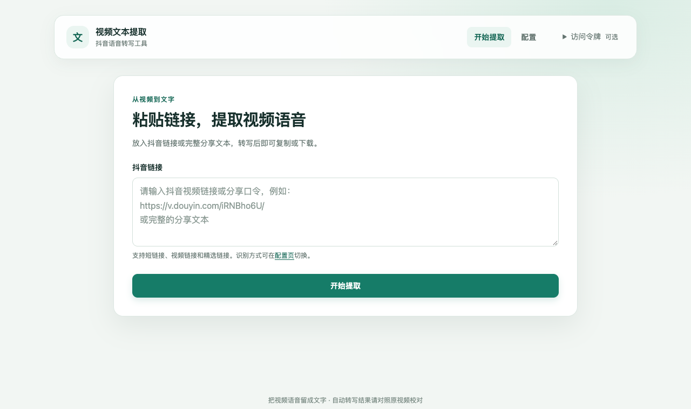

# 抖音视频文本提取工具

粘贴抖音链接，把视频里的语音转成可复制、下载的文字。支持本地 Web 界面和命令行，可选择云端 DashScope，或在本机运行 SenseVoiceSmall / Whisper。

[](https://github.com/likebeans/douyin_text_extraction/actions/workflows/ci.yml)
[](https://www.python.org/)
[](LICENSE)



## 能做什么

- 解析抖音短链接、视频链接、精选页链接和完整分享文本。
- 在 Web 页面提取、阅读、复制转写结果，或下载为 `.txt`；适配手机屏幕。
- 通过 CLI 输出 Markdown、TXT、JSON，支持指定保存路径。
- 在配置页选择识别方式与本地模型；密钥留空保留已有值。
- 可选使用 OSS 作为 DashScope 直接识别失败后的备用流程。

这是**语音转写**工具，不读取画面中的字幕，也不保证逐字准确。方言、背景音乐、多人重叠说话及商品型号仍可能识别错误，请对照原视频校对。平台页面或访问策略变化也可能导致部分链接无法提取。

## 选择识别方式

| 方式 | 需要什么 | 音频处理位置 | 适合的使用方式 |
| --- | --- | --- | --- |
| **SenseVoiceSmall** | FFmpeg、`local-chinese` 可选依赖 | 本机 CPU | 中文口语，无需 API Key，自带标点 |
| **Whisper** | FFmpeg、`local` 可选依赖 | 本机 CPU / CUDA GPU | 希望自行选择模型大小，权衡资源与速度 |
| **DashScope** | DashScope API Key | 阿里云 | 希望减少本机计算量；按服务方规则计费 |

默认配置为 DashScope；本地模式的默认引擎为 Whisper。SenseVoiceSmall 首次下载约 **163 MB**，解压后约 **240 MB**。Whisper 的模型大小各不相同，更大不一定对每段音频都更准确。模型来源、资源取舍与独立权重许可见 [语音识别方式](docs/ASR_PROVIDER_GUIDE.md)。

## 快速开始

需要 **Python 3.10+** 和 [uv](https://docs.astral.sh/uv/getting-started/installation/)。

```bash
git clone https://github.com/likebeans/douyin_text_extraction.git
cd douyin_text_extraction
cp .env.example .env
```

Windows PowerShell 使用 `Copy-Item .env.example .env`。如果已有 `.env`，直接编辑，不要覆盖已有配置。以下三种方式任选一种。

### 方式一：本地中文识别

先安装 [FFmpeg](https://ffmpeg.org/download.html) 并确保 `ffmpeg -version` 能运行。macOS 可使用 `brew install ffmpeg`，Ubuntu / Debian 可使用 `sudo apt install ffmpeg`。

```bash
uv sync --locked --extra local-chinese
```

编辑 `.env`：

```dotenv
ASR_PROVIDER=local
LOCAL_ASR_ENGINE=sensevoice
```

启动 Web：

```bash
uv run --extra local-chinese douyin-web
```

### 方式二：本地 Whisper

同样需要 FFmpeg：

```bash
uv sync --locked --extra local
```

编辑 `.env`：

```dotenv
ASR_PROVIDER=local
LOCAL_ASR_ENGINE=whisper
WHISPER_MODEL=base
```

```bash
uv run --extra local douyin-web
```

可选模型为 `tiny`、`base`、`small`、`medium`、`large`、`turbo`，也可以在 Web 配置页切换。首次使用会下载所选模型；CPU 转写可能需要较长时间。

### 方式三：DashScope 云端识别

```bash
uv sync --locked
```

从 [DashScope 控制台](https://dashscope.console.aliyun.com/apiKey) 获取 Key，编辑 `.env`：

```dotenv
ASR_PROVIDER=dashscope
DASHSCOPE_API_KEY=你的真实APIKey
ASR_MODEL=paraformer-v2
```

```bash
uv run douyin-web
```

直接云端识别不需要本地 FFmpeg；启用 OSS 备用流程时才需要。媒体 URL 会交给 DashScope；若走 OSS 备用流程，还会将提取的音频上传到你配置的 Bucket。

### 打开页面

浏览器访问 **<http://127.0.0.1:5000>**，粘贴抖音链接，点击“开始提取”。结果可直接复制或下载。首次下载模型、长视频转写期间请保持页面打开。

如果 5000 端口被占用，在 `.env` 设置 `FLASK_PORT=5187` 后重启，访问 <http://127.0.0.1:5187>。

> **本地引擎启动时请保留 `--extra`。** `uv run` 会同步依赖；省略对应选项可能移除之前安装的可选引擎。同时保留两种引擎时，安装和运行都使用 `--extra local --extra local-chinese`。

## 命令行使用

以下命令以 SenseVoiceSmall 为例，需先按上面的步骤配置 `.env`。使用 Whisper 时把 `--extra local-chinese` 换为 `--extra local`；使用 DashScope 时省略 `--extra`。

```bash
# Markdown（默认），保存到 output/douyin_<视频ID>.md
uv run --extra local-chinese douyin-extract extract "抖音链接或分享文本"

# TXT / JSON
uv run --extra local-chinese douyin-extract extract "抖音链接" --format txt
uv run --extra local-chinese douyin-extract extract "抖音链接" --format json

# 指定输出路径
uv run --extra local-chinese douyin-extract extract "抖音链接" --format json --output reports/result.json

# 不写输出文件，只把 JSON 输出到终端
uv run --extra local-chinese douyin-extract extract "抖音链接" --format json --no-save

# 离线检查配置、引擎依赖与 FFmpeg
uv run --extra local-chinese douyin-extract config-check
```

JSON 模式的标准输出只包含 JSON，诊断信息写到标准错误。`--output` 只给文件名时写入 `OUTPUT_DIR`，包含目录时使用指定路径。CLI 支持用 `--asr-provider local` 或 `--asr-provider dashscope` 临时覆盖识别提供商；本地引擎仍由 `LOCAL_ASR_ENGINE` 指定。

## 配置与部署

配置优先级为：**显式参数 > 环境变量 > `.env` > 默认值**。本机 Web 配置页将修改保存到 `.env`，在后续请求生效；环境变量提供的值不能被页面覆盖。`.env` 已被 Git 忽略，不要提交真实密钥。

| 配置项 | 默认值 | 用途 |
| --- | --- | --- |
| `ASR_PROVIDER` | `dashscope` | `dashscope` 或 `local` |
| `LOCAL_ASR_ENGINE` | `whisper` | `whisper` 或 `sensevoice` |
| `WHISPER_MODEL` | `base` | Whisper 模型大小 |
| `MAX_VIDEO_DURATION` | `600` | 视频时长上限，秒 |
| `OUTPUT_DIR` | `./output` | CLI 默认输出目录 |
| `DOWNLOAD_TIMEOUT` | `300` | 媒体下载总时限，秒 |
| `FLASK_PORT` | `5000` | Web 端口 |

完整变量与超时说明见 [环境变量配置](docs/ENV_CONFIG_GUIDE.md)。

### 其他设备访问

默认只监听 `127.0.0.1`。需要远程访问时，先设置随机 `WEB_API_TOKEN`，再设置 `FLASK_HOST=0.0.0.0`，保持 `FLASK_DEBUG=false`，并通过 HTTPS 反向代理提供访问。页面顶部“访问令牌”可以输入令牌；令牌仅保留在当前页面内存，刷新或切换页面后需要重新填写。

API 客户端使用 `Authorization: Bearer <token>` 或 `X-API-Token`。反向代理的 Origin 配置及接口格式见 [外部访问说明](docs/web-external-access.md) 和 [API 文档](docs/API对接文档.md)。

### Docker Compose

准备 `.env`，配置所选识别方式，并设置非空 `WEB_API_TOKEN`。令牌可用 `openssl rand -hex 32` 生成。

```bash
# DashScope
docker compose up -d --build

# SenseVoiceSmall：.env 同时设置 ASR_PROVIDER=local、LOCAL_ASR_ENGINE=sensevoice
INSTALL_CHINESE_ASR=true docker compose up -d --build

# Whisper：.env 同时设置 ASR_PROVIDER=local、LOCAL_ASR_ENGINE=whisper
INSTALL_LOCAL_ASR=true docker compose up -d --build
```

构建选项也可写入 `.env`，便于后续重建或在 PowerShell 使用。Compose 将宿主机端口绑定到 `127.0.0.1`，容器使用 Waitress、关闭调试并禁用配置 API；请从宿主机编辑 `.env` 后重建服务。`output/` 和 `temp/` 会挂载到宿主机；默认未挂载模型缓存，重建容器后可能重新下载模型。

```bash
docker compose logs -f douyin-api
docker compose down
```

## 常见问题

**为什么还有错字或重复？** 语音识别不是人工字幕。Whisper 已关闭跨窗口前文提示以减少重复循环；SenseVoice 会分段识别并生成标点。口音、弱人声、音乐和品牌词仍可能出错，工具不会按重复词强行删除正文，也不会根据标题编写台词。

**提示本地识别依赖未安装？** 检查 `LOCAL_ASR_ENGINE`，安装对应的 `local` 或 `local-chinese` 可选依赖，并在启动命令中保留 `--extra`。切换 Web 配置不会自动安装 Python 依赖。

**视频详情获取或下载失败？** 页面暂缺详情时会有限重试，但私密、已删除、访问受限的视频及平台结构变化仍可能失败。先确认原链接能访问，再查看终端日志、网络和下载限制。程序不绕过登录或验证码。

**为什么提取时一直等待？** `/api/extract` 是同步请求，目前没有任务进度百分比。首次模型下载或 CPU 转写可能较慢；可查看服务端日志。超过并发上限会返回 `429`。

**本地模式是否完全离线？** 识别在本机执行，但解析链接、下载视频和首次获取模型仍需要网络。

## 开发与测试

```bash
# 与 CI 一致：包含中文引擎，默认测试不下载模型或访问外部服务
uv sync --locked --all-groups --extra local-chinese
uv run --locked --extra local-chinese pytest
uv build --wheel
```

普通测试使用临时工作目录并拦截网络。真实 OSS 测试默认跳过，仅在显式 `--run-integration` 时启用。开发流程见 [CONTRIBUTING.md](CONTRIBUTING.md)，问题反馈请使用 [GitHub Issues](https://github.com/likebeans/douyin_text_extraction/issues)。

## 文档与许可

- [语音识别方式与模型许可](docs/ASR_PROVIDER_GUIDE.md)
- [环境变量配置](docs/ENV_CONFIG_GUIDE.md)
- [OSS 备用流程](docs/OSS_GUIDE.md)
- [Web API 对接](docs/API对接文档.md)
- [文档索引](docs/README.md) · [变更记录](CHANGELOG.md) · [安全策略](SECURITY.md)

项目代码采用 [MIT](LICENSE) 许可，当前包版本为 `0.3.0`。**模型权重不随代码分发，也不自动适用项目许可。** SenseVoiceSmall 由 FunASR / FunAudioLLM 提供，适用独立的 [FunASR 模型协议](https://github.com/modelscope/FunASR/blob/58830eca4012644aac0c3218c3ccc7d98f003fda/MODEL_LICENSE)；商业使用解释仍待许可方确认，详见 [官方讨论](https://github.com/QwenAudio/SenseVoice/issues/334)。
